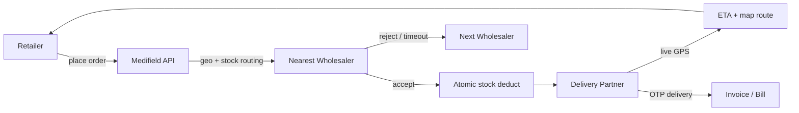

# Medifield

Medifield is a pharmaceutical supply-chain platform connecting **Retailers**, **Wholesalers**, **Delivery partners**, and **Admins**. Retailers search a medicine catalogue and place orders; the system routes each order to the geographically nearest wholesaler with stock (falling back to admin priority rank when coordinates are missing). Wholesalers have five minutes to accept or reject — on timeout or reject the order cascades to the next candidate. Once accepted, stock is deducted atomically, a delivery partner is assigned, and both retailer and admin track the rider live with a real ETA. An invoice is generated on delivery.

## Architecture



### Roles

| Role | Capabilities |
|------|----------------|
| **Retailer** | Search medicines, place/cancel orders, live tracking, order history |
| **Wholesaler** | Accept/reject/pack orders, self-service inventory |
| **Delivery** | Auto GPS tracking, navigation, status updates, OTP delivery |
| **Admin** | User verification, medicine catalogue CRUD, network overview |

### Order lifecycle

`WAITING_WHOLESALER` → `ACCEPTED` → `PACKED` → `PICKED` → `OUT_FOR_DELIVERY` → `DELIVERED`

- Reject/timeout cascades to next wholesaler → eventually `REJECTED`
- Retailer may `CANCEL` before pickup (stock restored if already deducted)
- Real-time updates via Socket.IO + persisted notifications

## Repository layout

```
medifield/
├── server/          # Node.js + Express + MongoDB API
├── client/          # React + Tailwind frontend
├── docker-compose.yml
└── .github/workflows/ci.yml
```

## Local setup

### Prerequisites

- Node.js 20+
- MongoDB 7+ (or use Docker Compose)

### Backend

```bash
cd server
cp .env.example .env   # edit JWT_SECRET and MONGO_URI
npm install
npm run dev            # http://localhost:5000
npm run seed:demo      # optional demo data
```

### Frontend

```bash
cd client
npm install
npm start              # http://localhost:3000
```

### Docker (recommended — includes replica-set MongoDB for transactions)

```bash
docker compose up --build
```

- API: http://localhost:5000
- UI: http://localhost:3000
- MongoDB runs as a single-node replica set so multi-document transactions work end-to-end

## Environment variables

| Variable | Required | Description |
|----------|----------|-------------|
| `MONGO_URI` | Yes | MongoDB connection string |
| `JWT_SECRET` | Yes | Secret for signing access tokens |
| `JWT_ACCESS_EXPIRES_IN` | No | Access token TTL (default `15m`) |
| `JWT_REFRESH_EXPIRES_IN` | No | Refresh token TTL (default `7d`) |
| `CORS_ORIGINS` / `CORS_ORIGIN` | No | Allowed frontend origin |
| `WHOLESALER_WAIT_MINUTES` | No | Accept/reject window (default `5`) |
| `REDIS_URL` | No | Enables Socket.IO Redis adapter for multi-instance |
| `LOG_LEVEL` | No | Pino log level (default `info`) |
| `ADMIN_CODE` | No | Code required to register admin accounts |

## Tests

```bash
cd server
npm test        # Jest unit tests (geo, routing, inventory, bills, notifications)
npm run lint    # ESLint
```

CI (GitHub Actions in `server/.github/workflows/ci.yml`) runs backend lint + tests on every push/PR.

For a production frontend build check from the monorepo root:

```bash
cd client
CI=true npm run build
```

## API highlights

- `POST /api/auth/login` — returns short-lived access token + refresh token
- `POST /api/auth/refresh` — rotate refresh token
- `GET /api/medicines/search` — paginated search with `imageUrl`
- `POST /api/orders/create` — geo-routed order placement
- `POST /api/orders/cancel` — retailer cancellation with stock restore
- `GET /api/notifications` — inbox with unread count

## Demo credentials

After `npm run seed:demo`, check `server/scripts/seedDemoData.js` for seeded accounts.
